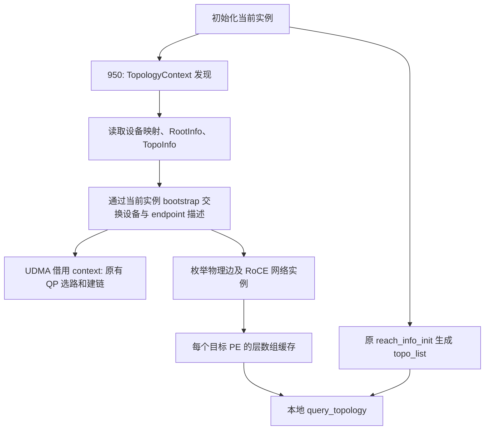

# PE 通信引擎与网络层拓扑查询

实现基线：`a23c173`（shmem1019）。保留该版本的 UDMA 回退、跨 server/网络实例检查与 shared jetty，实现 RFC 的查询增量。迁移与验收说明见 [1019 合并说明](../../tests/topology/README_1019_MERGE.md)。

`aclshmemx_query_topology()` 查询**当前激活实例中，本 PE 到目标 world PE** 的关系。它是初始化后的本地 Host 查询，无文件读取、无通信、无分配；每次读取一个 PE 的缓存，查表与结果装配为 O(1)。实例索引查找沿用现有 map。

## C++ 接口

声明在 `include/host/init/shmem_host_init.h`，通过 `shmem.h` 导出，使用既有 C++ Host 头文件约定及 C linkage。

```cpp
aclshmemx_topology_t info = ACLSHMEMX_TOPOLOGY_INITIALIZER;
int status = aclshmemx_query_topology(peer, ACLSHMEMX_TOPOLOGY_QUERY_ENGINES, &info);
if (status == ACLSHMEM_SUCCESS) {
    bool sdma = (info.engine_mask & ACLSHMEM_DATA_OP_SDMA) != 0;
    // 按需使用 sdma。
}
```

950 上可以请求 `ACLSHMEMX_TOPOLOGY_QUERY_LINKS`，也可与 ENGINES 按位或。成功后遍历 `info.net_layers[0 .. info.net_layer_count)`。返回层按数值升序排列、去重：0（Mesh）、1（Clos）、3（符合描述契约的 RoCE 网络）。同一层的多个端口、plane、IO DIE、EID 不会重复返回。self 的 LINKS 为空，ENGINES 沿用原有 self 规则。

| 项目 | 语义 |
| --- | --- |
| ENGINES | A2/A3/950 均支持；当前实例的使能可达引擎集合 |
| LINKS | 950 支持；初始化时物理描述的网络层连通关系 |
| 实际 QP | 使用 `aclshmemx_get_qp_num/get_qp_net_layer` 查询，不由 LINKS 保证 |
| 未请求的结果组 | `engine_mask=0` 或 `net_layer_count=0, net_layers=nullptr` |
| 空结果 | 合法；不存在本期可表达的关系时返回 0/nullptr |

ENGINES 对应已有 `data_op_engine_type_t`，必须转换内部 `aclshmem_transport_t`：内部 ROCE=2、SDMA=4；公开 SDMA=2、ROCE=4。MTE=1、UDMA=8 不变。

| 返回值 | 条件 |
| --- | --- |
| `ACLSHMEM_INVALID_PARAM` | output 为 null |
| `ACLSHMEM_INVALID_VALUE` | mask 为零/含未知位、size 小于 64、ABI 不是 1、PE 越界 |
| `ACLSHMEM_NOT_INITED` | 当前实例未成功初始化 |
| `ACLSHMEM_NOT_SUPPORTED` | A2/A3 请求含 LINKS 的 mask，包括 ENGINES\|LINKS |
| `ACLSHMEM_SUCCESS` | 完整返回所请求的信息 |

先检查 output、mask 和布局，再检查初始化、PE 范围及平台支持。错误返回只消费 status。

## ABI 与所有权

64 位 Host 上，结构体大小 64、对齐 8；字段偏移为 size=0、version=4、engine=8、count=12、pointer=16、reserved=24。v1 最小 size 固定为 64，接受更长的同版本对象；仅逐字段写入 engine/count/pointer，保留 size/version、reserved 以及更长对象的尾部。调用者用 initializer 将 reserved 清零。

顶层对象由调用者持有，网络层数组由实例持有。借用有效期到**所属实例 finalize 开始**；切换当前实例不会改变数组所有者。必须在 finalize 前用完或复制，不可写入数组。初始化/查询/finalize 使用现有 `g_aclshmem_ctx_mutex → entity_map_mutex_` 锁序。应用仍需串行组织实例选择与后续调用，以及返回指针的使用与 finalize。

## 数据如何产生



- A2/A3 不编译 TopoReader/context，ENGINES 复用原 `topo_list`。
- 950 每个 SHMEM 实例在 DEVICE_SIDE entity 创建前执行一次发现，HOST_SIDE entity 复用。MTE-only 也执行，因此需要有效的 950 物理描述。
- RootInfo 沿用原读取规则：优先 `/etc/hccl_rootinfo.json`；缺失或 JSON 解析失败时使用既有生成器。合法 JSON 但缺少必要字段会使初始化失败。TopoInfo 路径来自 RootInfo。
- UDMA 通过 `TransportOptions::topologyContext` 借用；独立 HYBM UDMA 入口自行持有 context，并调用同一个 builder。
- Mesh 遍历该 local-ID 对的所有边，校验端口、层和相同非空网络实例；Clos 校验附件的 raw layer、topology instance、端口、plane，显式 CLOS 还校验端点层及网络实例。
- TOPO_FILE_DESC 依据当前物理边和端口归属匹配；合并 raw layer 0 中的 Mesh/Clos 沿既有产品规则归一化为 0/1。
- RoCE layer 3 要求双方均为显式 CLOS、相同非空网络实例、相同非空 plane，以及相同 IPV4/IPV6 地址族。此结果依据网络实例的全互通声明，不能代替端口健康检测或数据面实测。
- 物理匹配接受 EID/IP 地址描述；原 UDMA 选路仍筛选 EID，保持 QP 策略及聚合端口择优行为。
- 成功发布 initialized 之前缓存定型；失败回滚和 finalize 先释放借用者，再删除实例 context。每个 PE 保存自身一行关系，无全局 N×N 查询矩阵。

## 初始化成本与失败处理

builder 保留 4 次发现数据 allgather：EID slot count、local ID、MessagePack 长度、MessagePack 内容。增加 3 次状态一致性交换，分别保护解析/序列化及元数据分配、接收缓存分配、解码。SHMEM 路径另有 context 分配和最终层缓存发布各 1 次状态交换，共 **9 次 topology 相关 allgather**。UDMA 借用路径不重复发现；独立 HYBM 路径额外协调获取当前设备的结果，共 9 次。其他原有初始化/建链交换未计入。

失败协调用固定大小栈数组，避免处理 OOM 时再分配状态缓冲。接收空间乘法和 bootstrap 的 int 长度检查在通信前完成。通信层自身失败返回 `ACLSHMEM_BOOTSTRAP_ERROR`；本机制不承诺从进程失联或底层 collective 故障恢复。

持久内存为 `O(topology_input + N×E + N×L)`，L 最大为 3；交换临时空间按最大 endpoint 序列化长度乘 N 分配。实际发现耗时、通信字节数、内存峰值和查询延迟需在目标环境记录。MTE-only 新增发现成本必须单独评估。

## Python

```python
from shmem.core import query_topology
engines = query_topology(peer)                     # {"engine_mask": ...}
both = query_topology(peer, links=True)             # 950
layers = query_topology(peer, engines=False, links=True)
```

Native `_pyshmem.aclshmemx_query_topology(pe, mask)` 返回 `(status, payload)`，保持 GIL 至数组复制完成。高层 wrapper 还持有现有 `_instance_lock`，与会释放 GIL 的 finalize/实例切换串行；失败抛 `AclshmemError`。返回字典仅含请求的键，layers 是独立整数列表，可在 finalize 后使用。直接 native/C++ 调用者自行满足生命周期约定。

## 验证与限制

本机可运行：

```bash
python3 tests/topology/run_host_tests.py --json /path/to/json-v3.11.3 --gtest /path/to/googletest-v1.14.0
python3 tests/topology/test_python_topology.py
```

便携测试实际编译 `topo_reader.cpp`、`topology_context.cpp` 和原有 parser/route UT；仅替代 runtime、driver 与文件工具接口。Host 查询函数体从生产文件原样提取，配合最小 backend fixture 检查契约和缓存。两种平台宏分支在 ASan/UBSan 下运行。此方式不覆盖整个 `shmem_init.cpp`/UDMA manager 的 CANN 集成编译、动态库符号导出、完整初始化/释放、pybind native 编译或真实网络。

目标服务器必须完成以下构建及对应单测：

```bash
bash scripts/build.sh -soc_type Ascend910B -uttests
bash scripts/build.sh -soc_type Ascend950 -uttests -examples
bash scripts/build.sh -soc_type Ascend950 -multi_link -uttests -examples
bash scripts/build.sh -soc_type Ascend950 -multi_link -enable_rdma -rdma_backend XSCALE -uttests
bash scripts/build.sh -soc_type Ascend950 -multi_link -enable_rdma -rdma_backend HNS_1825 -uttests
```

A2/A3 公共契约测试位于 host/init；950 物理层测试位于 host/topo，按已有 CMake 过滤进入普通或 `aclshmem_rdma_topo_unittest`。新 context.cpp 被既有递归源文件规则收集，其他平台排除。

实机需覆盖单侧/双侧 IO DIE、MTE-only、UDMA-only、RoCE-only、组合引擎、1/2/4 QP 与不同 policy、多实例切换和重复 init/finalize。固定物理输入，LINKS 必须保持；ENGINES/实际 QP 可按配置变化。RoCE layer 3 要核验真实全互通；双层样例要核对数据及路径 trace。当前开发机没有 CANN/NPU，以上实机项尚未执行。


追加的平台、引擎配置、可达性、query_mask 和 CMO 边界详见 [返回与验收矩阵](topology_matrix.md)。950 SDMA 仅用于 CMO，不计入 D2D engine_mask；UDMA 还需非 self 的实际 QP0 路由。


2026-10-19补齐：正式初始化在setup_heap之后增加远端能力门禁，任一非self能力为空时汇合返回-100，发布initialized之前结束；门禁增加一次状态allgather。新增本机全矩阵入口 `python3 tests/topology/run_acceptance.py`，再用 `python3 tests/topology/report_acceptance.py` 输出分层验收记录。设备项按用户选择保持NOT_RUN，九份上传topo继续采用明确标注的模拟RootInfo；详见 [验收说明](../../tests/topology/README_ACCEPTANCE.md)。
